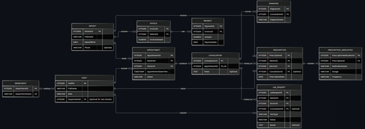

# MIT 8103 Advanced Database Systems: Portfolio Summary

**Name:** Emmanuel Olanrewaju  
**Student ID:** 301929207  
**Case Study:** Hospital Management System for Metricare Specialist Hospital  
**Repository:** [MIT 8103 Advanced Database Systems Portfolio](https://github.com/LanreFoan/Olanrewaju_Emmanuel_301929207)

---

## Case Study

MetriCare Specialist Hospital is a simulated, multi-department outpatient facility that supports registration, specialist appointments, consultations, diagnoses, laboratory requests, prescriptions, and billing.

The portfolio applies relational modeling, SQL optimization, transactions, NoSQL, and distributed system design to a single consistent hospital scenario.

PostgreSQL 18/pgAdmin 4 and local MongoDB/mongosh/Compass were used for practical exercises; all patient and clinical examples are fictional.

---

## Portfolio 1 — Database Design and Modeling

I designed an 11-table relational model:

1. Patients
2. Departments
3. Staff
4. Appointments
5. Consultations
6. Diagnosis
7. LabRequest
8. Prescriptions
9. PrescriptionMedication
10. Invoice
11. Payment

The ER diagram defines one-to-many relationships and the one-to-zero-or-one appointment–consultation relationship.

Separate medication and payment rows reduce repetition; the normalization notes explain the progression to third normal form (3NF).

Primary and foreign keys, `NOT NULL`, `UNIQUE`, and `CHECK` constraints enforce integrity, while a partial unique index addresses conflicts in active doctor bookings.

The recorded constraint-test exercise reports **12 deliberately invalid inserts rejected**, including a missing patient date of birth (`SQLSTATE 23502`).

### Entity Relationship Diagram

*Figure 1. MetriCare Specialist Hospital ER diagram (Portfolio 1). Full-size diagram available in the GitHub repository.*

---

## Portfolio 2 — Query Processing and Optimization

To protect the original hospital records, a separate `p2_benchmark` schema held **100,000 synthetic appointment-history rows**.

A date-range search for 10 November 2026 returned 55 rows.

Before indexing, `EXPLAIN (ANALYZE, BUFFERS)` showed a Sequential Scan with 99,945 rows removed by the filter.

After creating a B-tree index on `appointment_datetime`, the execution plan used:

- Bitmap Index Scan
- Bitmap Heap Scan

The reported three-run averages were:

| Performance Metric | Before Indexing | After Indexing |
|---|---:|---:|
| Average execution time | 16.457 ms | 0.337 ms |
| Execution strategy | Sequential Scan | Bitmap Index Scan + Bitmap Heap Scan |
| Matching records | 55 | 55 |

The average execution times imply an approximately **97.95% reduction**.

This percentage is indicative: the second 13.682 ms baseline run is not independently established by the available captures, and the exact three small post-index times were reported rather than supplied as screenshots.

The execution-plan change itself is evidenced.

---

## Portfolio 3 — Transactions and Concurrency

I used a separate `p3_demo.invoice_demo` table to test hospital billing without changing Portfolio 1 records.

A `COMMIT` persisted a 10,000 payment against a 50,000 invoice.

A `ROLLBACK` restored the prior committed balance after an attempted extra payment.

Under the `READ COMMITTED` isolation level:

- Session A showed a 30,000 uncommitted balance.
- Session B read the earlier 25,000 committed value.
- After Session A committed, Session B read 30,000.

For concurrency control, `SELECT ... FOR UPDATE NOWAIT` produced the expected lock-conflict error `SQLSTATE 55P03` in Session B.

A subsequent successful execution demonstrated that the conflicting lock had been released.

The portfolio contains session SQL and pgAdmin evidence, with noted limits on some intermediate screenshots.

---

## Portfolio 4 — NoSQL and Advanced Data Models

Using MongoDB locally, I created the `metricare_nosql` database with two collections:

- `patients`
- `consultations`

The design references patients by `patientId` and embeds diagnoses, laboratory requests, and prescriptions within each consultation document.

Three fictional consultations modelled:

1. Hypertension
2. Knee Osteoarthritis
3. Anaemia

MongoDB queries demonstrated document retrieval, dot-notation searches, and aggregation.

The positional update of laboratory request `501` returned:

- `matchedCount: 1`
- `modifiedCount: 1`

This changed the Lipid Profile status to `Completed`.

A pending-test query returned the Full Blood Count request in consultation `1003`.

Aggregation counted each diagnosis once.

A temporary test patient (ID `999`) was deleted successfully (`deletedCount: 1`), without deleting the clinical examples.

---

## Portfolio 5 — Distributed and Cloud Database Exercise

I selected the **discussion-based alternative** expressly permitted by the assessment, rather than deploying a cloud database.

The proposed future architecture places MongoDB consultation documents in a managed, three-member replica set consisting of:

- One primary node
- Two secondary nodes

PostgreSQL would be retained for suitable relational workflows.

The discussion distinguishes replication for resilience from sharding for future horizontal scalability.

It examines:

- Replica lag
- Elections and failover interruptions
- Read and write concerns
- Authentication and encryption
- Least-privilege access
- Independent backups
- Data governance

Editable Mermaid diagrams describe the proposed topology.

No Atlas cluster, sharding, replication experiment, or cloud availability measurement was performed.

---

## Key Technical Outcomes

| Portfolio | Outcome / Distinction |
|---|---|
| Relational integrity | 11 hospital tables; constraints and ER/cardinality evidence. |
| Query optimisation | Selective date-range index; Sequential-to-Bitmap plan change. |
| Concurrent transactions | COMMIT / ROLLBACK / READ COMMITTED / NOWAIT lock conflict. |
| Document database | Nested consultation CRUD plus diagnosis aggregation. |
| Distributed design | Conceptual replica set and future sharding analysis. |

---

## Evidence

The GitHub repository is organised into five portfolio directories:

1. `portfolio-1-database-design`
2. `portfolio-2-query-optimisation`
3. `portfolio-3-transactions-concurrency`
4. `portfolio-4-nosql`
5. `portfolio-5-distributed-cloud`

Each activity links its source scripts or model documentation to supporting screenshots where applicable.

**GitHub Repository:**  
https://github.com/LanreFoan/Olanrewaju_Emmanuel_301929207

---

## Individual Technical Reflection

The work strengthened my ability to connect data-model choices to database behaviour rather than relying on SQL execution alone.

Designing the ER model clarified entity relationships and integrity rules.

Portfolio 2 taught me to inspect execution plans and to distinguish observed index use from claims about guaranteed speed.

Portfolio 3 showed why transaction boundaries and two independent sessions matter; an initial premature `COMMIT` required correcting the isolation procedure.

Portfolio 4 highlighted the convenience of embedded clinical records alongside the responsibility to manage references and updates.

Portfolio 5 helped me distinguish redundancy through replication from horizontal scaling through sharding.

---

## AI-Use Declaration

I used OpenAI ChatGPT to assist with database concepts, troubleshooting, SQL/JavaScript examples, performance calculations, and the wording of my documentation.

Practical queries were executed locally by me using fictional data, and the outputs were reviewed against screenshots from pgAdmin, mongosh, and Compass.

I understand the results, corrected any discrepancies, and remain responsible for their accuracy before submission.

Portfolio 5 is a documented proposal, not a cloud implementation.

---

## References

1. PostgreSQL Global Development Group. *PostgreSQL 16: Constraints.*  
   https://www.postgresql.org/docs/16/ddl-constraints.html

2. PostgreSQL Global Development Group. *PostgreSQL 18: Using EXPLAIN.*  
   https://www.postgresql.org/docs/18/using-explain.html

3. MongoDB. *MongoDB Manual — Data Modelling, CRUD, Replication and Sharding.*  
   https://www.mongodb.com/docs/manual/

4. PostgreSQL Global Development Group. *PostgreSQL 16: Transaction Isolation.*  
   https://www.postgresql.org/docs/16/transaction-iso.html

5. MongoDB. *Replication.*  
   https://www.mongodb.com/docs/manual/replication/

