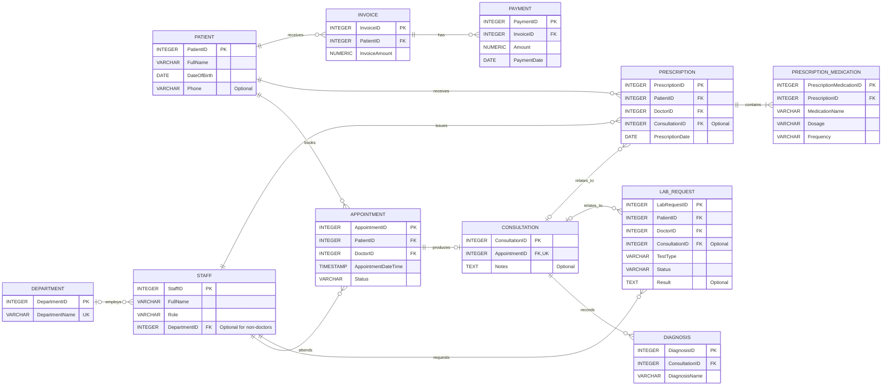

# MeriCare specialist hospital management system (simulated) ER Diagram

## Explanation of Keys and Relationships

### Primary Key (PK)
A primary key uniquely identifies each record in a table. For example, `PatientID` identifies each patient and cannot be duplicated.

### Foreign Key (FK)
A foreign key connects a record to another table. For example, `PatientID` in the `APPOINTMENT` table identifies the patient associated with an appointment.

### Unique Key (UK)
A unique key prevents duplicate values in a field or combination of fields. For example, `DepartmentName` must be unique. The unique `AppointmentID` reference in `CONSULTATION` ensures that an appointment has at most one consultation.

### Relationship Symbols
`||` means exactly one,
`o{` means zero or many,
`o|` means zero or one,
`|{` means One or many

**For example, `PATIENT ||--o{ APPOINTMENT` means that each appointment belongs to exactly one patient, while a patient can have zero or many appointments.
