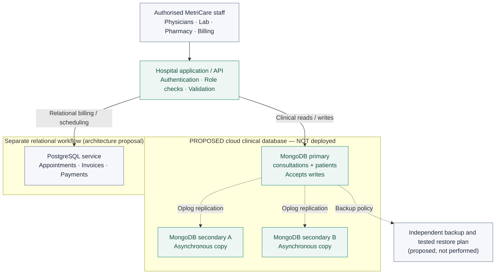

# Cloud Architecture Diagrams

**Interpretation note:** All cloud services and replication arrows below are **proposed/hypothetical**. The only completed MongoDB exercise is the **local, single-server** Portfolio 4 document database. These are *editable Mermaid source diagrams* intended to render directly on GitHub.

## Proposed initial replica-set architecture

**Interpretation:**

- **Primary/secondary** are *roles*, not fixed physical servers. Elections can change which member is primary.
- Replication is **asynchronous**, so the secondaries may be behind the primary.
- The standalone relational workflow represents a **design boundary**, not a claim that the existing local PostgreSQL database has been migrated or connected to Atlas.
- Backup is a separate protection from replica copies; neither backups nor restores have been performed in this portfolio.
**Note:** No direct network path from the real local Portfolio 4 database to this proposed cloud deployment is shown, because no such connection exists in the completed exercise.

For detailed component responsibilities: [Proposed_Architecture.md](Emmanuel_Olanrewaju_301929207_P5_Proposed_Architecture.md).
